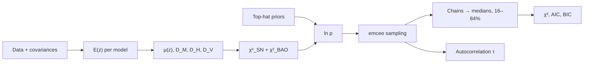

import Fact from '@site/src/components/xi/Fact';
import CrossReferences from '@site/src/components/CrossReferences';

{/* facts: _facts/xi/results/protocol1b_pantheon_desi/summary_protocol1b_combined.txt · docs/reproducibility.md (command) · config: src/xi_protocol1b_bao_run.py @ 25ed86e */}

# Inference Pipeline

This section documents how a set of cosmological parameters becomes a posterior and a model ranking. Everything is implemented in one self-contained script, `src/xi_protocol1b_bao_run.py`, run once per model on the same data: <Fact path="data.n_sne" format="int" /> supernovae and <Fact path="data.n_bao" /> BAO measurements.

---

## Pipeline position

| Step | Page | One-line summary |
|---|---|---|
| Priors | [Prior Specification](./priors.mdx) | Uniform, bounded; Ξosc amplitude is one-sided |
| Likelihood | [Likelihood Functions](./likelihood.md) | Gaussian, full covariance, no nuisance parameters |
| Sampling | [MCMC Setup](./mcmc-setup.md) | `emcee`, <Fact path="run.nwalkers" /> walkers, <Fact path="run.nsteps" format="int" /> steps in the final run |
| Diagnostics | [Convergence Diagnostics](./convergence.md) | N/50 > τmax criterion |
| Ranking | [Model Comparison](./model-comparison.md) | AIC and BIC from the best sampled point |

:::info[Same procedure for every model]
ΛCDM, CPL and Ξosc share data, covariances, sampler, walker count, steps and burn-in. Only the expansion history and the parameter vector change.
:::

---

## Cross-references

<CrossReferences links={[
  { href: '/xi-dark-energy/overview/models', label: 'Three Model Families', relation: 'The equations being fitted' },
  { href: '/xi-dark-energy/results/parameter-constraints', label: 'Parameter Constraints', relation: 'What the pipeline returns', featured: true },
  { href: '/xi-dark-energy/reproducibility', label: 'Reproducibility', relation: 'Rerun it' },
  { href: '/xi-dark-energy/api', label: 'API Reference', relation: 'Function-level documentation' },
]} />
