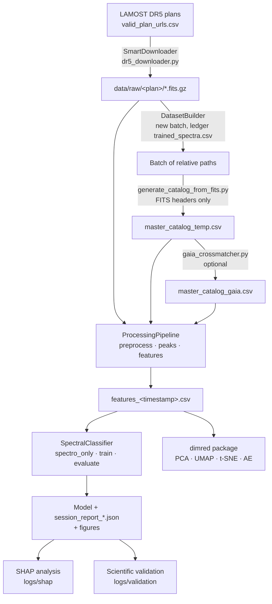

import RelatedPages from '@site/src/components/RelatedPages';

{/* facts: none — page derived from the module docstrings of AS/src/tools/dr5_downloader.py, dataset_builder.py, generate_catalog_from_fits.py, gaia_crossmatcher.py, pipeline/*.py (no run-level number) */}

# Data Lifecycle

This page follows one batch of spectra from download to prediction and interpretation, naming for each stage the module that performs it and the file it leaves behind. It is a map: details live on the linked pages, and no run-level number appears here.

---

## Overview

## Stages

| # | Stage | Module | Output | Documented in |
|---|---|---|---|---|
| 1 | **Download** — resumable, round-robin across observing plans, atomic `.part` → final rename, session log | `tools/dr5_downloader.py` (`SmartDownloader`) | `data/raw/<plan>/<file>.fits.gz`, `logs/download_log_*.txt`, completed plans in `downloaded_plans.csv` | [Downloading Data](../guides/downloading-data) |
| 2 | **Batch selection** — never reuses a spectrum from a previous session | `tools/dataset_builder.py` (`DatasetBuilder`) | list of relative paths; ledger `trained_spectra.csv` | [Dataset Versions](../data/dataset-versions) |
| 3 | **Catalogue** — header fields only, flux arrays untouched | `tools/generate_catalog_from_fits.py` | `master_catalog_temp.csv` | [Master Catalog](../data/master-catalog) |
| 4 | **Gaia cross-match** (optional) | `tools/gaia_crossmatcher.py` | `master_catalog_gaia.csv` | [Gaia DR3 Cross-match](../data/gaia-dr3) |
| 5 | **Preprocessing** — load flux and inverse variance, sanitise, normalise | `pipeline/preprocessor.py` | arrays in memory | [Preprocessing](../pipeline/preprocessing) |
| 6 | **Peak detection** | `pipeline/peak_detector.py` | `match_*` values | [Peak Detection](../pipeline/peak-detection) |
| 7 | **Feature extraction** and catalogue join | `pipeline/feature_engineering.py`, `processing.py` | `features_<timestamp>.csv` | [Processing Pipeline](../pipeline/processing-pipeline), [Feature Catalogue](../data/feature-catalog) |
| 8 | **Classification** — train/test split, optional feature selection, calibration, evaluation | `pipeline/classifier.py` | model file, `*_meta.json`, `session_report_*.json`, confusion/ROC/PR/calibration figures | [Classification](../pipeline/classification) |
| 9 | **Interpretation and validation** — SHAP, physical checks | notebooks `03_…`, `04_…` | `logs/shap/`, `logs/validation/` | [SHAP Interpretability](../science/shap-interpretability), [Scientific Validation](../science/validation) |
| 10 | **Dimensionality reduction** (parallel branch, unsupervised) | `dimred/*` | run reports `.json` + `.txt`, figures | [Dimensionality Reduction](../dimred) |

Steps 2–8 are chained by [`MasterPipeline`](../pipeline/master-pipeline).

## Where the data generations enter

The same lifecycle produced two generations of feature tables, kept separate throughout the documentation: the **PHY-3500 · G1 · 43,019 spectra** set (dimensionality reduction) and the **349,998-spectra G2** set (reference classifier). See [Dataset Versions](../data/dataset-versions).

## Where filtering and exclusion happen

| Place | What is excluded | Page |
|---|---|---|
| Gaia step | Gaia columns of sources with high RUWE are masked | [Quality Filters](../data/quality-filters) |
| Feature extraction | Spectra that fail to load or compute are skipped | [Processing Pipeline](../pipeline/processing-pipeline) |
| Classifier | Non-A/F/G/K/M classes; non-spectroscopic columns in `spectro_only` mode | [`spectro_only` mode](./spectro-only-mode) |
| Dimensionality-reduction loader | Low-SNR spectra, sparse columns | [Quality Filters](../data/quality-filters) |

---

## Artefact conventions

- File names carry a UTC timestamp (`YYYYMMDDTHHMMSSZ`), shared by the model, its metadata, the session report and the figures of one session.
- Intermediate state of a session is stored in `session_pending.json` so that a long Gaia step is not repeated after a restart.
- Raw data and catalogues are not versioned in Git (`data/` is ignored); only code and documentation are.

---

<RelatedPages pages={[
  { href: '/docs/astrospectro/concepts/pipeline-overview', title: 'Pipeline Overview', desc: 'Conceptual view of the processing chain', category: 'concepts' },
  { href: '/docs/astrospectro/overview/project-map', title: 'Project Map', desc: 'Modules and their dependencies', category: 'concepts' },
  { href: '/docs/astrospectro/pipeline/master-pipeline', title: 'Master Pipeline', desc: 'The orchestrator', category: 'concepts' },
  { href: '/docs/astrospectro/concepts/reproducibility', title: 'Reproducibility', desc: 'Session records', category: 'concepts' },
]} />
