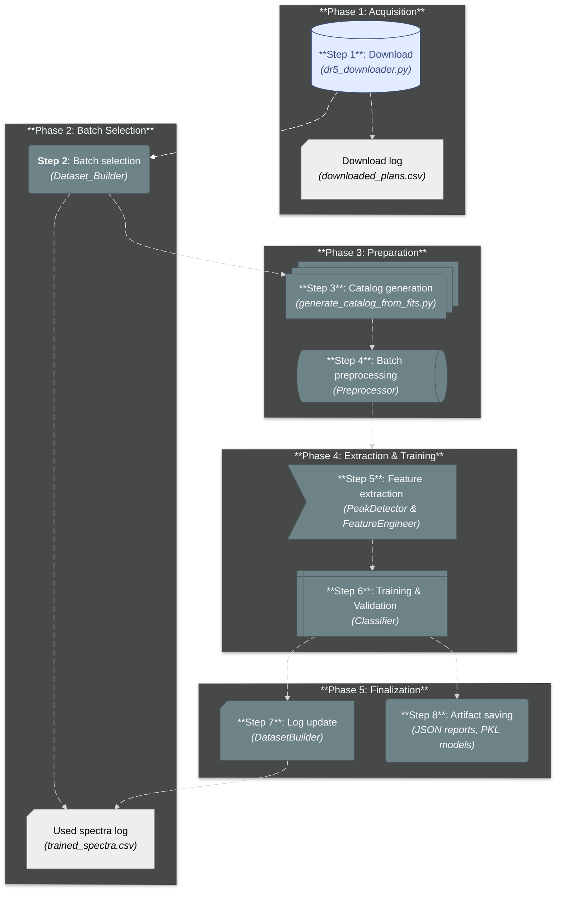

{/* Complete for v1.0.0 release once graph is completed */}

# Pipeline Overview

This page presents the complete workflow of the **AstroSpectro** project, from raw data acquisition to the generation of classification results. The pipeline is designed as a sequence of modular steps.

## Workflow diagram

> The diagram below illustrates the main phases of the pipeline. Each phase is implemented by one or more specific modules in the source code.

## Phase description

### 1. Acquisition (optional)

The starting point. `SmartDownloader` retrieves raw spectra from the **LAMOST** servers and stores them locally. It logs completed observation plans in `downloaded_plans.csv` to avoid redundant downloads.

### 2. Session preparation

At each run, `DatasetBuilder` selects a new batch of unused spectra by consulting the `trained_spectra.csv` log. A **local catalogue** is then generated from the **FITS** headers of this batch, so the analysis relies on precise, up-to-date metadata.

### 3. Processing and modelling

`ProcessingPipeline` takes the batch and its local catalogue and runs the processing chain: preprocessing, line detection and extraction of the feature vector. The resulting feature table goes to `SpectralClassifier`, which handles hyperparameter tuning and training (the reference model is XGBoost; see [Model Card](../science/model-card.mdx)).

### 4. Finalisation

Once the model is trained, `DatasetBuilder` updates `trained_spectra.csv` with the spectra just used. The session artefacts (the `.pkl` model and a detailed JSON report) are saved in `data/models/` and `data/reports/` for traceability and reproducibility.
