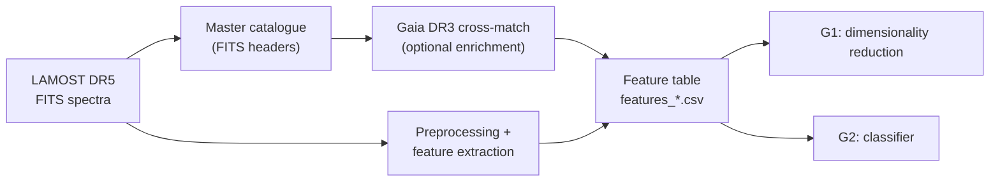

import RunFact from '@site/src/components/RunFact';
import RelatedPages from '@site/src/components/RelatedPages';

{/* facts:
  G1 · runs.json `pca` (phy3500_pca_run_20260408T012751Z): n, p, class_counts, features_file — source _facts/astrospectro/data/reports/runs/phy3500_pca/phy3500_pca_run_20260408T012751Z.json (shapes.X)
  G2 · runs.json `classifier` (20260522T161236Z): n.processed, trained_on_file, features.candidates, features.selected, classes — source session_report_xgboost_20260522T161236Z.json + _meta.json
  FACTS_INDEX §0 (generations), §5 (catalogue). Not in runs.json, not published here: G2 class counts (last_config_used.json), G2 column count (csv_summaries.json). */}

# Data & Datasets

This page is the entry point to the data used by AstroSpectro: where the spectra come from, how they are enriched, and which derived tables the analyses run on. Two **data generations** coexist in the project and are never mixed in a single result: **PHY-3500 (G1)**, used by every dimensionality-reduction page, and the **350k-spectrum generation (G2)**, used by the reference classifier.

---

## Data generations

| | **G1 — PHY-3500** | **G2 — 350k** |
|---|---|---|
| Feature file | <RunFact run="pca" path="features_file" format="raw" /> | <RunFact path="trained_on_file" format="raw" /> |
| Spectra | N = <RunFact run="pca" path="n" /> (STAR <RunFact run="pca" path="class_counts.STAR" /> · GALAXY <RunFact run="pca" path="class_counts.GALAXY" /> · QSO <RunFact run="pca" path="class_counts.QSO" />) | <RunFact path="n.processed" /> spectra processed |
| Features | p = <RunFact run="pca" path="p" /> spectroscopic descriptors | <RunFact path="features.candidates" /> candidate columns → <RunFact path="features.selected" /> selected by the classifier |
| Used by | PCA, UMAP, t-SNE, HDBSCAN, autoencoder (PHY-3500 article) | Reference XGBoost classifier (<RunFact path="label" format="raw" />), its SHAP analysis and the scientific validation |
| Label on the site | **PHY-3500 · G1 · <RunFact run="pca" path="n" /> spectra** | Run name of the classifier |

:::caution[Do not mix the generations]
The classifier was never evaluated on the PHY-3500 dataset. A classification metric must not be attached to the G1 spectrum count, and a dimensionality-reduction result must not be presented as a property of the G2 data. The reference classifier also contains Gaia/photometric columns — see the [Data Leakage Audit](../concepts/data-leakage-audit.mdx).
:::

---

## From archive to feature table

| Data product | Content | Page |
|---|---|---|
| LAMOST DR5 spectra | Low-resolution optical spectra (FITS), flux and inverse variance on a log-linear wavelength grid | [LAMOST DR5](./lamost-dr5.mdx) |
| Gaia DR3 cross-match | Astrometry, photometry and GSP-Phot parameters added to the catalogue | [Gaia DR3](./gaia-dr3.md) |
| Master catalogue | One row of header metadata per spectrum, optionally enriched with Gaia | [Master Catalog](./master-catalog.md) |
| Feature table | One row per spectrum, `feature_*` and `match_*` columns plus catalogue columns | [Feature dataset](./feature-dataset.mdx) · [Feature catalogue](./feature-catalog.md) |
| Class labels | Harvard type taken from the LAMOST `subclass` | [Class Taxonomy](./class-taxonomy.md) |
| Quality filters | SNR and Gaia RUWE criteria | [Quality Filters](./quality-filters.md) |
| Versions | Successive feature tables and their sizes | [Dataset Versions](./dataset-versions.md) |

---

## Class setup

The G1 dataset keeps the LAMOST object classes (STAR, GALAXY, QSO). The reference classifier works on stellar types only — <RunFact path="classes" format="raw" /> — and excludes <RunFact path="class_filter.classes" format="raw" />; see [Classification](../pipeline/classification.md#labels-and-class-filtering).

---

## What is not documented yet

The exported fact pack does not contain the Gaia cross-match statistics (match rate, effective radius) or the number of spectra removed at each quality-filter step; these figures are therefore not published.

---

<RelatedPages pages={[
  { href: '/docs/astrospectro/dimred/data-loader', title: 'PHY-3500 dataset', desc: 'G1 loader, filters and standardisation', category: 'science' },
  { href: '/docs/astrospectro/science/model-card', title: 'Model Card', desc: 'G2 reference classifier', category: 'science' },
  { href: '/docs/astrospectro/pipeline', title: 'Core Pipeline', desc: 'How the feature table is produced', category: 'concepts' },
  { href: '/docs/astrospectro/guides/downloading-data', title: 'Guide — Downloading data', desc: 'Fetch LAMOST DR5 spectra', category: 'guides' },
]} />
