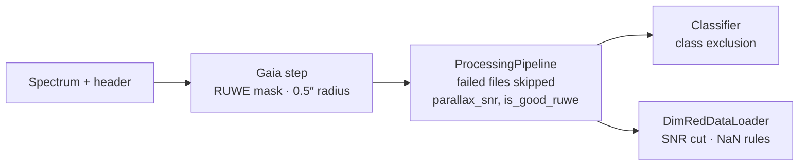

import RunFact from '@site/src/components/RunFact';
import GaiaLeakNote from '@site/src/components/GaiaLeakNote';
import RelatedPages from '@site/src/components/RelatedPages';

{/* facts: runs.json classifier (class_filter.classes, class_filter.rows_removed) · code: AS/src/dimred/data_loader.py, AS/src/tools/gaia_crossmatcher.py, AS/src/pipeline/feature_engineering.py, AS/src/pipeline/classifier.py */}

# Quality Filters

AstroSpectro has no single "quality filter" stage. Criteria are spread over four places in the code, each with its own definition and effect. This page lists them **as implemented**, and states which ones remove rows and which only mask values. Row counts after each step are not recorded in the documentation data pack, so none are quoted.

:::caution[Common misreadings corrected here]
- The SNR cut is `snr_r ≥ 10` (inclusive), not "> 10".
- RUWE ≥ 1.4 does **not** reject the spectrum: the Gaia columns are set to NaN and the row is kept.
- The classifier applies **no** SNR cut: SNR columns are only excluded as features.
:::

---

## Where each criterion applies

### 1. Cross-match (`gaia_crossmatcher.py`)

| Criterion | Value | Effect |
|---|---|---|
| Search radius | 0.5″ (default) | Closest Gaia source within the radius is kept; otherwise Gaia columns are empty |
| RUWE | `ruwe ≥ 1.4` (parameter `ruwe_max`) | **Masking**: all Gaia columns of the row set to NaN; row kept |
| Absolute magnitude `M_G` | `parallax > 0` and `parallax_snr ≥ 5` | `M_G` defined only for these rows, NaN otherwise |

### 2. Processing pipeline (`processing.py`, `feature_engineering.py`)

| Criterion | Value | Effect |
|---|---|---|
| File readable and feature computation successful | — | Failed spectra are skipped and counted in a printed warning |
| `is_good_ruwe` | `ruwe < 1.4` | Binary feature (int8), not a filter |
| Distance-related columns | `min_parallax_snr = 5` | Parallax-based quantities defined only above this SNR |
| Main-sequence offset `delta_ms` | `parallax_snr ≥ 10`, good RUWE | Polynomial fitted on clean stars; NaN elsewhere |
| Magnitude sentinel | 99.0 | Replaced by NaN before colours are computed |
| Empty columns | all-NaN | Dropped from the final table |

### 3. Dimensionality-reduction loader (`dimred/data_loader.py`)

`DimRedDataLoader.load()` applies, in this order:

| Step | Default | Effect |
|---|---|---|
| SNR cut | `snr_band="snr_r"`, `snr_min=10.0`, comparison `>=` | **Removes** spectra below the threshold; skipped with a warning if the column is absent |
| Class filter | none | Optional list such as `STAR`, `GALAXY`, `QSO` |
| Column rules | NaN fraction > 10 % per column | Column **dropped** (not the rows) |
| Column rules | constant columns, identifiers, labels, non-numeric, SNR columns | Column dropped |
| Residual NaN | any NaN left in a kept feature column | Row **dropped** |
| Optional balancing | `class_balance`, `n_per_class` | Fixed-seed subsampling |

The values actually used for the published PHY-3500 · G1 · 43,019 spectra analysis are not stored in the run reports, so this page can state the loader's defaults but not confirm them for that run.

### 4. Classifier (`classifier.py`)

| Criterion | Effect |
|---|---|
| Class exclusion | Rows of excluded classes are removed before training. The reference run excludes `B, C, D, S, W, s` (<RunFact run="classifier" path="class_filter.rows_removed" format="int" /> rows removed) and keeps A, F, G, K, M |
| SNR | Columns `snr_u … snr_z` are excluded from the candidate features; **no row is removed on SNR** |
| `spectro_only` | Additional feature exclusion by column-name prefix (see [`spectro_only` mode](../concepts/spectro-only-mode)) |

<GaiaLeakNote />

---

## What is not documented

Per-step counts (spectra before and after the SNR cut, number of RUWE-masked sources, number of failed reads) are printed in the pipeline logs and notebooks but are not part of the exported data. A new export containing them would allow a funnel table on this page.

---

<RelatedPages pages={[
  { href: '/docs/astrospectro/data/master-catalog', title: 'Master Catalog', desc: 'Where snr_* and ruwe come from', category: 'concepts' },
  { href: '/docs/astrospectro/data/gaia-dr3', title: 'Gaia DR3 Cross-match', desc: 'Radius and RUWE masking', category: 'concepts' },
  { href: '/docs/astrospectro/dimred/data-loader', title: 'PHY-3500 Dataset', desc: 'Loader used by the dimensionality-reduction pages', category: 'science' },
  { href: '/docs/astrospectro/data/lamost-dr5', title: 'LAMOST DR5', desc: 'The survey and its SNR bands', category: 'concepts' },
  { href: 'https://github.com/PhD-Brown/AstroSpectro/blob/main/src/dimred/data_loader.py', title: 'Source — data_loader.py', desc: 'DimRedDataLoader on GitHub', category: 'external' },
]} />
