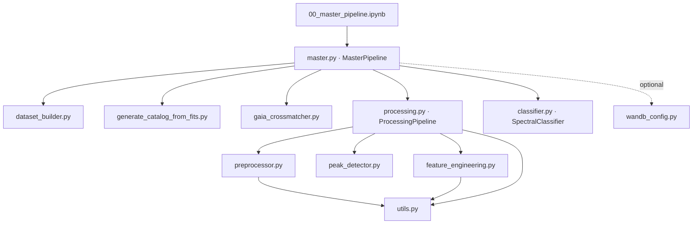
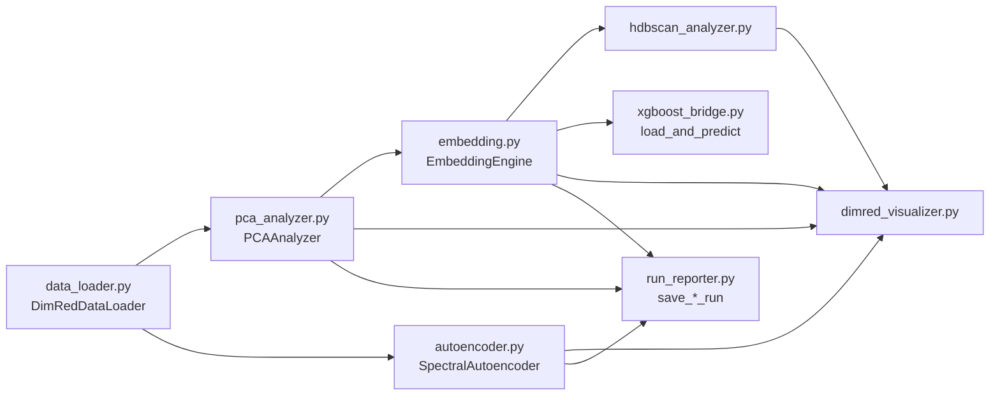

import RelatedPages from '@site/src/components/RelatedPages';

{/* facts: none — page derived from import statements and module docstrings of the PhD-Brown/AstroSpectro repository (src/, notebooks/, app.py) */}

# Project Map

This page maps **how the modules of the AstroSpectro repository depend on each other** and which entry point drives which part. For the directory layout and the role of each folder, see [Project Structure](../concepts/project-structure); for the order in which data flows through the modules, see [Data Lifecycle](../concepts/data-lifecycle). The map was built from the `import` statements and module docstrings of the repository.

---

## Module dependency graph

Arrows read "imports / calls".

`tools/visualizer.py` (`AstroVisualizer`, used by `app.py`) sits beside this chain: it imports `preprocessor`, `feature_engineering`, `classifier`, `peak_detector` and `utils`. `spectra_manager.py` drives `dr5_downloader.py` from notebooks.

## `src/pipeline` — the processing and training chain

| Module | Main objects | Depends on |
|---|---|---|
| `master.py` | `MasterPipeline` (orchestration, dashboard, session reports) | `dataset_builder`, `generate_catalog_from_fits`, `gaia_crossmatcher`, `processing`, `classifier`; `wandb_config` on demand |
| `processing.py` | `ProcessingPipeline` | `preprocessor`, `peak_detector`, `feature_engineering`, `utils` |
| `preprocessor.py` | `SpectraPreprocessor`, `ProcessedSpectrum` | `utils` (inverse-variance helpers) |
| `peak_detector.py` | `PeakDetector`, `matches_to_dataframe`, `matches_to_series` | NumPy, SciPy only |
| `feature_engineering.py` | `FeatureEngineer`, `SpectralLineLibrary`, Gaia and photometric composites | `utils` |
| `classifier.py` | `SpectralClassifier`, `CollinearityFilter`, `ThresholdTunedClassifier` | scikit-learn, XGBoost |
| `wandb_config.py` | `should_use_wandb`, `init_wandb_run` | `wandb` (optional) |

`src/pipeline/master (1).py` is an older copy of `master.py` and is not imported by anything.

## `src/tools` — data management and visualisation

| Module | Role |
|---|---|
| `dr5_downloader.py` | Resumable download of LAMOST DR5 spectra |
| `spectra_manager.py` | Notebook-facing wrapper around the downloader, plus clean-up and backup of `data/raw/` |
| `dataset_builder.py` | Selection of unused spectra and the trained-spectra ledger |
| `generate_catalog_from_fits.py` | FITS headers → catalogue CSV |
| `gaia_crossmatcher.py` | Gaia DR3 enrichment |
| `visualizer.py` | `AstroVisualizer`: spectrum, line and model figures, built on `preprocessor`, `feature_engineering`, `classifier`, `peak_detector` |

## `src/dimred` — the dimensionality-reduction package (PHY-3500)

`dimred/__init__.py` is a façade: it re-exports the public objects so notebooks use `from dimred import …` without depending on file names.

The package reads the feature CSV and the Gaia catalogue produced by the pipeline but does not import `src/pipeline` modules; `xgboost_bridge` only loads a serialised classifier to project its predictions onto the UMAP space. The arrows above show the **data flow** between components in a typical notebook, not Python imports; `__init__.py` is the only module that imports the others.

## Notebooks and entry points

| Entry point | Purpose |
|---|---|
| `notebooks/00_master_pipeline.ipynb` | Master notebook: batch → catalogue → features → training |
| `notebooks/01_download_spectra.ipynb` | Spectra download |
| `notebooks/02_tools_and_visuals.ipynb` | Exploration and figures |
| `notebooks/03_scientific_validation.ipynb` | Physical validation |
| `notebooks/04_shap_interpretability.ipynb` | SHAP analysis |
| `notebooks/dimred/phy3500_01_pca.ipynb`, `…02_umap_tsne.ipynb`, `…03_autoencoder.ipynb` | PHY-3500 dimensionality-reduction analyses |
| `app.py` | Imports `AstroVisualizer` and `setup_project_env` |
| `scripts/` | Environment setup and clean-up scripts |

---

<RelatedPages pages={[
  { href: '/docs/astrospectro/concepts/project-structure', title: 'Project Structure', desc: 'Directories and root files', category: 'concepts' },
  { href: '/docs/astrospectro/concepts/data-lifecycle', title: 'Data Lifecycle', desc: 'Order of the processing steps', category: 'concepts' },
  { href: '/docs/astrospectro/pipeline', title: 'Pipeline Overview', desc: 'Hub of the pipeline pages', category: 'concepts' },
  { href: '/docs/astrospectro/api', title: 'API Reference', desc: 'Signatures and parameters', category: 'api' },
  { href: 'https://github.com/PhD-Brown/AstroSpectro', title: 'AstroSpectro repository', desc: 'Source code on GitHub', category: 'external' },
]} />
