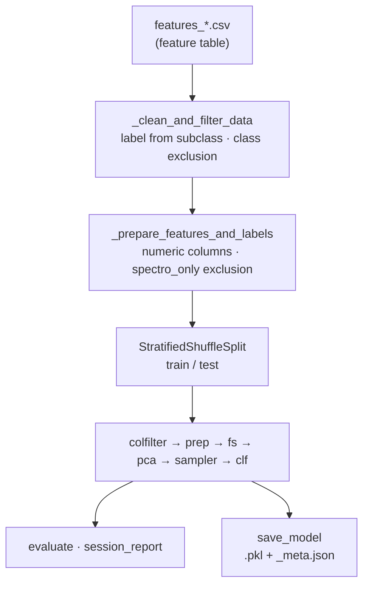

import RunFact from '@site/src/components/RunFact';
import RunProvenance from '@site/src/components/RunProvenance';
import TrainingConfig from '@site/src/components/TrainingConfig';
import RelatedPages from '@site/src/components/RelatedPages';

{/* facts:
  Code: AS/src/pipeline/classifier.py (SpectralClassifier, _clean_and_filter_data, _prepare_features_and_labels,
        _build_preprocessor, _build_estimator, train_and_evaluate, CollinearityFilter, ThresholdTunedClassifier,
        _ece_score, save_model, load_model)
  G2 · _facts/astrospectro/data/models/spectral_classifier_xgboost_20260522T161236Z_meta.json (best_params_, feature_names_used, selected_features_)
  G2 · _facts/astrospectro/data/reports/20260522T161236Z/session_report_xgboost_20260522T161236Z.json → runs.json `classifier`
  _facts/astrospectro/data/reports/last_config_used.json = config of v7 (VALIDATION_spectro_only_v7), cited only for sampler / weights settings. */}

# Classification

This page documents the last stage of the AstroSpectro pipeline: `SpectralClassifier` (`src/pipeline/classifier.py`), which builds labels from the LAMOST `subclass`, selects the numeric feature columns, and trains, evaluates and saves a classifier. The reference model is an XGBoost run on the 350k-spectrum generation (**G2**); its metrics are reported on [Classification Performance](../science/classification-performance.mdx) and the [Model Card](../science/model-card.mdx).

<RunProvenance keyResultsHref="../science/classification-performance" />

---

## Why this step exists

The feature table produced by the [processing pipeline](./index.md) mixes spectroscopic descriptors with catalogue, Gaia and observational columns, and its classes are strongly imbalanced. `SpectralClassifier` turns it into a reproducible model: one entry point (`train_and_evaluate`), a single scikit-learn pipeline that is fitted on the training split only, and a `.pkl` + `_meta.json` pair that records what the model saw.

---

## Pipeline position



---

## Labels and class filtering

`_clean_and_filter_data` creates the `label` column from `subclass` according to `prediction_target`:

| `prediction_target` | Label |
|---|---|
| `main_class` | First letter of the subclass (Harvard type) |
| `sub_class_top25` | The 25 most frequent subclasses |
| `sub_class_bins` | `X_early` (subtype digit < 5) or `X_late` (digit ≥ 5) for X in A, F, G, K, M |

Rows with null or invalid labels (`U`, `n`, `N`, `O`, `OTHER`) are dropped, and `exclude_classes` removes explicit classes. The reference run keeps the types <RunFact path="classes" format="raw" /> and excludes <RunFact path="class_filter.classes" format="raw" /> (<RunFact path="class_filter.rows_removed" /> rows removed).

---

## Feature columns and `spectro_only`

`_prepare_features_and_labels` keeps numeric columns only, replaces ±∞ by NaN, drops empty and constant columns, and sorts the remaining columns (`feature_names_used`). A fixed exclusion list always removes identifiers, coordinates, observational and instrument metadata, SNR per band, Gaia identifiers, GSP-Phot parameters (`teff_gspphot`, `logg_gspphot`, `mh_gspphot`, `distance_gspphot`), parallax, proper motions, RUWE and the Gaia catalogue magnitudes.

With `spectro_only=True`, every column whose name **starts with** one of these prefixes is excluded as well:

```python
non_spectro_prefixes = (
    "parallax", "pmra", "pmdec", "ruwe", "phot_", "bp_rp", "bp_g", "g_rp",
    "radial_velocity", "rv_", "teff", "logg", "fe_h", "alpha_fe", "dist_",
    "v_", "J_", "H_", "K_", "l_", "b_",
)
```

:::caution[Why the reference run contains Gaia columns]
The exclusion is prefix-based. Columns derived from Gaia after the cross-match — absolute magnitudes `M_G`, `M_BP`, `M_RP` (computed in `src/tools/gaia_crossmatcher.py`) and the extinction `ag_gspphot` — do not start with any of these prefixes, so they pass the `spectro_only` filter in this version of `classifier.py`.

Run v6 (`ST_350k_xgb_AFGKM_v6`) was trained with `spectro_only` enabled, but its <RunFact run="20260522T161236Z" path="features.selected" /> selected features include <RunFact run="20260522T161236Z" path="features.gaia_photometric.length" /> Gaia/photometric columns (`M_G`, `M_BP`, `M_RP`, `ag_gspphot`). Its metrics are therefore not purely spectroscopic; see the [Data Leakage Audit](../concepts/data-leakage-audit.mdx).
:::

---

## Train/test split

`train_and_evaluate` splits once, before any fitting, with `StratifiedShuffleSplit(n_splits=1, test_size=0.21, random_state=42)` (defaults of the method). With `use_groups=True` and a `group_col`, a group-aware split (`StratifiedGroupKFold`, fallback `GroupShuffleSplit`) keeps all spectra of a group on the same side. The reference run has <RunFact path="n.train" /> training and <RunFact path="n.test" /> test spectra.

---

## The training pipeline

All steps below are fitted on the training split only (inside each fold when a search is run):

| Step | Class | Default | Role |
|---|---|---|---|
| `colfilter` | `CollinearityFilter(var_threshold, corr_threshold)` | `corr_threshold=0.98` | Drops one column of each pair with \|r\| above the threshold (and low-variance columns if `var_threshold > 0`) |
| `prep` | `ColumnTransformer` → `SimpleImputer` + `StandardScaler` | `imputer_strategy="median"`, `scaler_type="standard"` | Imputation (`median`, `mean`, `most_frequent`, `knn`) and scaling (`standard`, `robust`, none) |
| `fs` | `SelectFromModel(selector, threshold)` or `RFECV` | selector `xgb`, threshold `median` | Keeps the features whose importance in a selector model exceeds the threshold |
| `pca` | `PCA(n_components)` | off (`use_pca=False`) | Optional decorrelation |
| `sampler` | `SMOTE`, `BorderlineSMOTE`, `SMOTEENN`, `ADASYN` (imbalanced-learn) | off (`sampler=None`) | Optional oversampling, applied inside folds |
| `clf` | `ThresholdTunedClassifier(base_estimator)` | `tune=False` | Wraps the model; can learn per-class thresholds on a validation subset (`f1_macro` or `balanced_accuracy`) |

`_build_estimator` supports RandomForest, XGBoost, SVM, ExtraTrees, LogRegOVR, KNN, MLP, NaiveBayes, LDA, QDA, CatBoost, LightGBM and SoftVoting.

### Class imbalance

Two mechanisms exist: per-sample weights (`use_balanced_weights=True` by default, `compute_sample_weight("balanced")`) and resampling (`sampler`). SMOTE is therefore an **option** of the code, not part of the reference configuration: the last exported configuration (`data/reports/last_config_used.json`) has `sampler: null` and `use_balanced_weights: true`.

### Hyperparameter search and cross-validation

With `search="grid"` or `"random"`, `GridSearchCV` / `RandomizedSearchCV` run on the training split with `StratifiedKFold(cv_folds=5, shuffle=True)` (or `RepeatedStratifiedKFold`, or a group-aware K-fold). Without `search`, the pipeline is fitted once with the given parameters. The reference run reused parameters from an earlier search (`notes`: <RunFact path="notes" format="raw" />).

### Probability calibration

With `calibrate_probs=True`, the final estimator is wrapped in `CalibratedClassifierCV` (`calibration_method="sigmoid"` or `"isotonic"`), either by internal cross-validation (`calibrate_cv`) or on a dedicated hold-out (`calibrate_holdout_size > 0`). `_ece_score` computes the expected calibration error over 15 confidence bins.

---

## Parameters used (reference run)

<TrainingConfig />

Selection reduced <RunFact path="features.candidates" /> candidate columns to <RunFact path="features.selected" /> features (`selected_features_` in the meta file).

---

## Persistence

`save_model(path)` writes the pickled `SpectralClassifier` and a `<path>_meta.json` that records `saved_at_utc`, the Python / NumPy / scikit-learn / XGBoost versions, `model_type`, `prediction_target`, `best_params_`, `class_labels`, `feature_names_used`, `selected_features_` and `trained_on_file`. `load_model(path)` restores the object.

```python
from src.pipeline.classifier import SpectralClassifier

clf = SpectralClassifier(model_type="XGBoost", prediction_target="main_class")
clf.train_and_evaluate(features_df, spectro_only=True, exclude_classes=["B", "C", "D", "S", "W", "s"])
clf.save_model("data/models/spectral_classifier_xgboost_<timestamp>.pkl")

clf = SpectralClassifier.load_model("data/models/spectral_classifier_xgboost_<timestamp>.pkl")
proba = clf.model_pipeline.predict_proba(X_new[clf.feature_names_used])
```

The session report written next to the model (`data/reports/<timestamp>/session_report_*.json`) holds the metrics, the confusion matrix and the selected features; see [Reproducibility](../concepts/reproducibility.md).

---

## Validation / sanity check

- Compare `selected_features` of the session report with the intended feature families: the presence of `M_*` or `ag_*` columns signals the leak described above.
- Check that test-set metrics are reported with balanced accuracy (the classes are imbalanced).
- The F/G boundary concentrates most errors; see [F/G Confusion Analysis](../science/fg-confusion.md).

---

<RelatedPages pages={[
  { href: '/docs/astrospectro/science/classification-performance', title: 'Classification Performance', desc: 'Metrics of the reference run', category: 'science' },
  { href: '/docs/astrospectro/concepts/spectro-only-mode', title: 'spectro_only mode', desc: 'What the mode is meant to exclude', category: 'concepts' },
  { href: '/docs/astrospectro/guides/model-training', title: 'Guide — Model training', desc: 'Training from the notebook interface', category: 'guides' },
  { href: '/docs/astrospectro/api/classifier', title: 'API — SpectralClassifier', desc: 'Class reference', category: 'api' },
]} />
