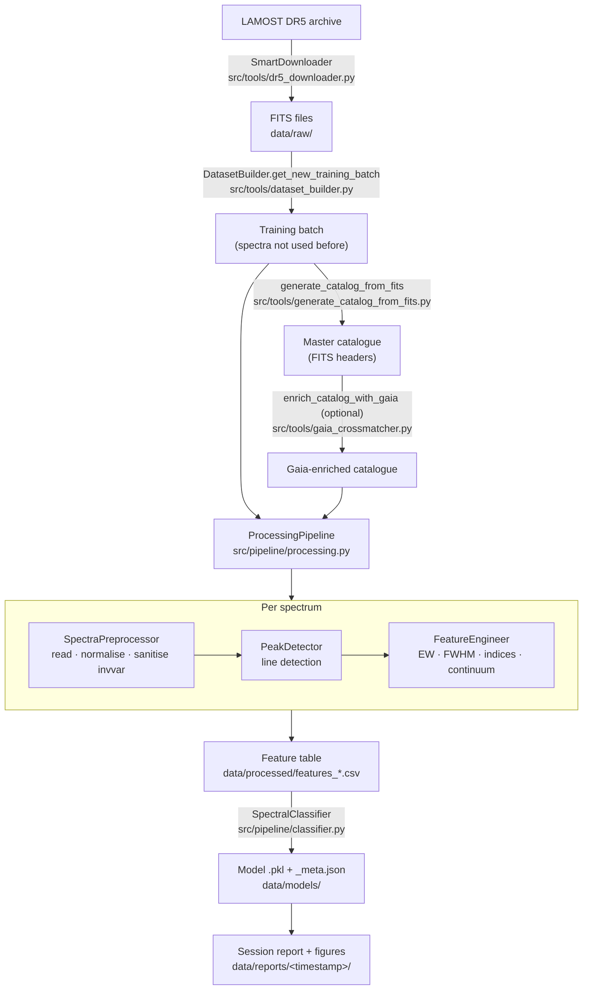

import RelatedPages from '@site/src/components/RelatedPages';

{/* facts: no run figures on this page.
  Code: AS/src/tools/{dr5_downloader,generate_catalog_from_fits,gaia_crossmatcher,dataset_builder}.py ;
        AS/src/pipeline/{master,processing,preprocessor,peak_detector,feature_engineering,classifier,wandb_config}.py ;
        AS/notebooks/00_master_pipeline.ipynb */}

# Core Pipeline

This page maps the AstroSpectro pipeline from raw LAMOST DR5 FITS files to a trained classifier: what each stage does, which module implements it and which page documents it. The whole chain is orchestrated by `MasterPipeline` (`src/pipeline/master.py`) and is usually driven from `notebooks/00_master_pipeline.ipynb`.

---

## Pipeline position



---

## Stages

| # | Stage | Module · entry point | What it produces | Page |
|---|---|---|---|---|
| 1 | Download | `src/tools/dr5_downloader.py` · `SmartDownloader` | FITS files organised by observing plan | [LAMOST DR5](../data/lamost-dr5.mdx) |
| 2 | Batch selection | `src/tools/dataset_builder.py` · `DatasetBuilder` | List of FITS paths not yet used for training (ledger `trained_spectra.csv`) | [Master Pipeline](./master-pipeline.md) |
| 3 | Catalogue | `src/tools/generate_catalog_from_fits.py` · `generate_catalog_from_fits` | One row of header metadata per spectrum | [Master Catalog](../data/master-catalog.md) |
| 4 | Gaia enrichment (optional) | `src/tools/gaia_crossmatcher.py` · `enrich_catalog_with_gaia` | Gaia DR3 astrometry, photometry and derived columns | [Gaia DR3](../data/gaia-dr3.md) |
| 5 | Preprocessing | `src/pipeline/preprocessor.py` · `SpectraPreprocessor` | Wavelength, median-normalised flux, sanitised inverse variance | [Preprocessing](./preprocessing.md) |
| 6 | Line detection | `src/pipeline/peak_detector.py` · `PeakDetector` | Detected absorption lines matched to the line list (`match_*` columns) | [Peak Detection](./peak-detection.md) |
| 7 | Feature extraction | `src/pipeline/feature_engineering.py` · `FeatureEngineer` | Spectroscopic descriptors (`feature_*` columns) | [Feature Engineering](./feature-engineering.md) · [theory](./feature-engineering-theory.mdx) |
| 8 | Batch processing | `src/pipeline/processing.py` · `ProcessingPipeline.run` | Feature table joined with the catalogue (parallel I/O + CPU) | [Processing Pipeline](./processing-pipeline.md) |
| 9 | Classification | `src/pipeline/classifier.py` · `SpectralClassifier` | Trained model, metrics, confusion matrix | [Classification](./classification.md) |
| 10 | Tracking (optional) | `src/pipeline/wandb_config.py` | Weights & Biases run, when enabled | [Experiment Tracking](./experiment-tracking.md) |

---

## Orchestration

`MasterPipeline` chains stages 2 to 9:

| Method | Stages |
|---|---|
| `select_batch(batch_size, strategy)` | 2 |
| `generate_and_enrich_catalog(enrich_gaia, **gaia_kwargs)` | 3–4 |
| `process_data()` | 5–8 |
| `run_training_session(...)` | 9 (and 10 when W&B is enabled) |
| `run_full_pipeline(...)` | 2–9 in one call, then records the batch in `trained_spectra.csv` |
| `interactive_training_runner()` | ipywidgets interface used in the notebook |

```python
from src.pipeline.master import MasterPipeline

pipe = MasterPipeline(
    raw_data_dir="data/raw/", catalog_dir="data/catalog/", processed_dir="data/processed/",
    models_dir="data/models/", reports_dir="data/reports/",
)
pipe.run_full_pipeline(batch_size=500, model_type="XGBoost", enrich_gaia=True)
```

Feature tables can also be reloaded without reprocessing (`load_features_from_csv`), which is how training sessions are usually run on a previously built table.

---

## Design choices

- **Spectroscopic features first.** The classifier is meant to rely on descriptors measured on the flux. Non-spectroscopic columns are excluded by `spectro_only`; the exclusion is incomplete in the reference run (see [Classification](./classification.md#feature-columns-and-spectro_only)).
- **No spectrum reused across sessions.** `DatasetBuilder` keeps a ledger of the spectra already used, so successive batches are disjoint.
- **Every run leaves a trace.** Models are saved with a `_meta.json`, and each training session writes a timestamped report directory; see [Reproducibility](../concepts/reproducibility.md).

---

<RelatedPages pages={[
  { href: '/docs/astrospectro/concepts/pipeline-overview', title: 'Pipeline overview', desc: 'Conceptual view of the same chain', category: 'concepts' },
  { href: '/docs/astrospectro/concepts/data-lifecycle', title: 'Data lifecycle', desc: 'Where each file lives and is reused', category: 'concepts' },
  { href: '/docs/astrospectro/guides/quick-start', title: 'Quick Start', desc: 'Run the pipeline end to end', category: 'guides' },
  { href: '/docs/astrospectro/data', title: 'Data & Datasets', desc: 'Inputs and the two data generations', category: 'science' },
]} />
