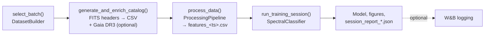

import RelatedPages from '@site/src/components/RelatedPages';

{/* facts: none — page derived from AS/src/pipeline/master.py and notebooks/00_master_pipeline.ipynb (no run-level number) */}

# Master Pipeline

`MasterPipeline` (`src/pipeline/master.py`) is the **orchestrator** of AstroSpectro: it chains batch selection, catalogue generation, optional Gaia enrichment, feature extraction and classifier training, and writes every artefact of the session (feature CSV, model, figures, JSON report). It is driven from the notebook `notebooks/00_master_pipeline.ipynb`, either step by step or through an interactive ipywidgets dashboard. This page describes the code; it quotes no run-level result.

---

## Pipeline position



## Public methods

| Method | Role | Main artefact |
|---|---|---|
| `select_batch(batch_size, strategy)` | Picks spectra never used in a previous session (ledger `trained_spectra.csv`); strategies `random` or `first` | `current_batch` |
| `generate_and_enrich_catalog(enrich_gaia, **gaia_kwargs)` | Builds the catalogue from FITS headers; if `enrich_gaia=True`, calls [`enrich_catalog_with_gaia`](../data/gaia-dr3) with the extra keyword arguments | `master_catalog_temp.csv` or `master_catalog_gaia.csv`, plus `session_pending.json` |
| `process_data()` | Runs the [processing pipeline](./processing-pipeline) with its default settings and saves the table | `features_<UTC timestamp>.csv` |
| `load_features_from_csv(...)` | Loads an existing feature file instead of recomputing it | `features_df` |
| `run_training_session(...)` | Trains and evaluates a model, saves the model, figures and report | `models/`, report directory |
| `run_full_pipeline(...)` | Chains the four steps above in one call | all of the above |
| `interactive_training_runner()` | ipywidgets dashboard to configure and launch runs | `last_config_used.json` |

### Session resumption

`generate_and_enrich_catalog` writes a `session_pending.json` file. If the kernel restarts after the (slow) Gaia cross-match, `process_data()` restores the pending session instead of repeating it; the file is cleared once the feature CSV is saved.

---

## Configuration: JSON presets, not YAML

There is no YAML configuration. Configuration comes from:

- **Keyword arguments** of the methods above.
- **The widget dashboard**, whose values can be saved and reloaded as a JSON **preset** (`_save_preset` / `_load_preset`, default file `preset.json` in the reports directory). Only widgets exposing a `value` are serialised; unknown keys are silently ignored when loading.
- **`last_config_used.json`**, written at each dashboard run, which records the exact parameters of the last session (model type, `spectro_only`, class exclusions, `use_wandb`, `random_state`…).

The dashboard also scans the reports directory for `session_report_*.json` files (`_load_runs_table`) to display and compare past sessions.

## Parallelism

`MasterPipeline` itself is sequential. Parallelism lives in the processing step (threads for I/O, processes for CPU — see [Processing Pipeline](./processing-pipeline)) and in the estimators' own `n_jobs` setting. `joblib` is imported only to serialise the trained model (`joblib.dump`); it is not used to parallelise the feature extraction.

## Experiment tracking

`MasterPipeline(..., use_wandb=False)` and `run_training_session(..., use_wandb=False)` make W&B opt-in. When enabled, `_log_to_wandb` reuses the session report and the figures already written to disk; see [Experiment Tracking](./experiment-tracking).

---

## Minimal example

```python
# notebooks/00_master_pipeline.ipynb
from utils import setup_project_env
from pipeline.master import MasterPipeline

paths = setup_project_env()
pipeline = MasterPipeline(
    raw_data_dir=paths["RAW_DATA_DIR"], catalog_dir=paths["CATALOG_DIR"],
    processed_dir=paths["PROCESSED_DIR"], models_dir=paths["MODELS_DIR"],
    reports_dir=paths["REPORTS_DIR"],
)
pipeline.select_batch(batch_size=500, strategy="random")
pipeline.generate_and_enrich_catalog(enrich_gaia=True, mode="auto", ruwe_max=1.4)
pipeline.process_data()
```

:::note[Duplicate file]
The repository also contains `src/pipeline/master (1).py`, an older copy of the module. This documentation refers to `master.py` only.
:::

---

<RelatedPages pages={[
  { href: '/docs/astrospectro/pipeline/processing-pipeline', title: 'Processing Pipeline', desc: 'What process_data() runs', category: 'concepts' },
  { href: '/docs/astrospectro/pipeline/experiment-tracking', title: 'Experiment Tracking (W&B)', desc: 'Opt-in logging of each session', category: 'concepts' },
  { href: '/docs/astrospectro/data/gaia-dr3', title: 'Gaia DR3 Cross-match', desc: 'The enrichment step', category: 'concepts' },
  { href: '/docs/astrospectro/api/master-pipeline', title: 'MasterPipeline API', desc: 'Signatures and parameters', category: 'api' },
  { href: 'https://github.com/PhD-Brown/AstroSpectro/blob/main/src/pipeline/master.py', title: 'Source — master.py', desc: 'MasterPipeline on GitHub', category: 'external' },
]} />
