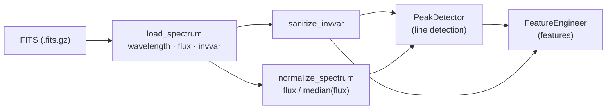

import RelatedPages from '@site/src/components/RelatedPages';

{/* facts: no run figures on this page.
  Code: AS/src/pipeline/preprocessor.py (SpectraPreprocessor, ProcessedSpectrum) ;
        AS/src/utils.py (sanitize_invvar, safe_sigma_from_invvar, make_stddev_uncertainty_from_invvar) ;
        AS/src/pipeline/processing.py (_load_spectrum_data, _compute_features_worker) ;
        AS/src/pipeline/feature_engineering.py (extract_features: StdDevUncertainty from invvar). */}

# Preprocessing

This page documents the preprocessing stage of the AstroSpectro pipeline: the conversion of one LAMOST DR5 FITS file into the three arrays used by line detection and feature extraction (wavelength, normalised flux, inverse variance). The stage is implemented by `SpectraPreprocessor` (`src/pipeline/preprocessor.py`) and the inverse-variance helpers of `src/utils.py`. For a hands-on walkthrough with interactive figures, see the [preprocessing guide](../guides/preprocessing.mdx).

---

## Why this step exists

Feature extraction measures line depths, widths and equivalent widths on the flux. Two properties of the raw data would make these measurements fragile:

- **Arbitrary flux scale.** LAMOST fluxes differ from one spectrum to the next by exposure, fibre throughput and source brightness. Without a common scale, the same line would give different depths for two identical stars.
- **Invalid inverse variances.** The variance row of a FITS file contains zeros, negative values or NaN at bad pixels. Converting them to uncertainties with `1/sqrt(invvar)` produces warnings, infinities or NaN that propagate into `specutils` measurements.

---

## Pipeline position



Preprocessing sits between the [catalogue / download tools](../data/index.md) and [peak detection](./peak-detection.md); see the [Core Pipeline](./index.md) for the full chain.

---

## What the preprocessor does

### 1. Reading the FITS file

`load_spectrum(hdul)` reads the primary HDU:

| Quantity | Source in the FITS file |
|---|---|
| Flux | `hdul[0].data[0]` (row 0) |
| Inverse variance | `hdul[0].data[1]` (row 1) |
| Wavelength | Reconstructed from the header: `λ_i = 10^(COEFF0 + i · COEFF1)` Å |

The wavelength grid is **log-linear**: each pixel has the same width in log λ. A `ValueError` is raised if the data array has fewer than two rows or if `COEFF0` / `COEFF1` are missing. Spectra are used on their native grid and assumed to be in the rest frame.

### 2. Flux normalisation

`normalize_spectrum(flux, method="median")` divides the flux by its median:

```python
med = float(np.median(flux))
if med <= 0 or not np.isfinite(med):
    warnings.warn(...)        # spectrum returned un-normalised
    return flux
return flux / med
```

The median is robust to absorption and emission lines and to isolated outliers. `"median"` is the only method implemented; any other value raises a `ValueError`. A spectrum whose median is non-positive or not finite is returned unchanged with a warning.

### 3. Inverse-variance sanitisation

`sanitize_invvar(invvar, min_val=1e-12)` replaces NaN, ±∞ and non-positive values by zero and then floors the array at `min_val`. Bad pixels therefore receive a vanishing inverse variance, i.e. a very large uncertainty, instead of an invalid value.

Two related helpers convert inverse variances into 1-σ uncertainties:

| Function | Invalid pixel → | Used by |
|---|---|---|
| `safe_sigma_from_invvar(invvar)` | σ = +∞ (or NaN with `bad_to_inf=False`) | `FeatureEngineer` (uncertainty of each `specutils.Spectrum`) |
| `make_stddev_uncertainty_from_invvar(invvar)` | σ from the floored inverse variance | `SpectraPreprocessor.prepare(..., return_uncertainty=True)` |

### 4. One-call interface

`prepare(hdul, normalize=True, return_uncertainty=False, min_invvar=1e-12)` chains the three steps and returns a `ProcessedSpectrum` dataclass with fields `wavelength`, `flux`, `invvar`, `flux_norm`, `invvar_clean` and `uncertainty`.

```python
from astropy.io import fits
from src.pipeline.preprocessor import SpectraPreprocessor

sp = SpectraPreprocessor()
with fits.open("path/to/spectrum.fits.gz") as hdul:
    spec = sp.prepare(hdul, normalize=True, return_uncertainty=True)

spec.wavelength, spec.flux_norm, spec.invvar_clean, spec.uncertainty
```

---

## In the batch pipeline

`ProcessingPipeline` (`src/pipeline/processing.py`) does not call `prepare()`; it splits the same operations between its two parallel phases:

| Phase | Operation |
|---|---|
| I/O (threads) | `load_spectrum` then `sanitize_invvar` on each file |
| CPU (processes) | `normalize_spectrum`, then `PeakDetector.analyze_spectrum` on the normalised flux and `FeatureEngineer.extract_features(…, flux_norm, invvar)` |

---

## What the preprocessor does not do

The stub of this page announced several operations; the code does not implement them:

| Operation | Status in the code |
|---|---|
| Resampling onto a common wavelength grid | **Not done** — each spectrum keeps its native log-linear grid; features are measured in wavelength windows |
| Flux clipping / outlier rejection | **Not done** on the flux — only the inverse variance is floored |
| Inverse-variance weighting | **Not done** in preprocessing — the inverse variance is only converted into uncertainties attached to the `specutils` spectra |
| Continuum fitting | Not part of preprocessing — the global continuum slope and curvature are fitted later, during feature assembly (quadratic fit on 4300–6800 Å of the normalised flux) |

---

## Known limitations

- **Uncertainty scale.** The flux is divided by its median, but the inverse variance is not rescaled by the same factor: the uncertainties attached to the normalised spectra are on the scale of the raw flux.
- **Median normalisation is not continuum normalisation.** Line depths are measured relative to the median flux level, not to a fitted local continuum; the overall spectral slope is preserved.
- **No redshift correction.** Spectra are assumed to be in the rest frame; stellar radial velocities shift line centres within the detection windows.

---

## Validation / sanity check

- The SNR test of the [scientific validation](../science/validation.md) finds no measurable dependence of the feature residuals on SNR.
- After `sanitize_invvar`, `np.isfinite(invvar).all()` and `(invvar > 0).all()` hold by construction.

---

<RelatedPages pages={[
  { href: '/docs/astrospectro/guides/preprocessing', title: 'Guide — Spectrum preprocessing', desc: 'Interactive walkthrough of the same steps', category: 'guides' },
  { href: '/docs/astrospectro/pipeline/peak-detection', title: 'Peak Detection', desc: 'Next stage: line detection on the normalised flux', category: 'concepts' },
  { href: '/docs/astrospectro/pipeline/feature-engineering-theory', title: 'Feature engineering — theory', desc: 'How the descriptors are measured', category: 'concepts' },
  { href: '/docs/astrospectro/api/preprocessor', title: 'API — SpectraPreprocessor', desc: 'Class reference', category: 'api' },
]} />
