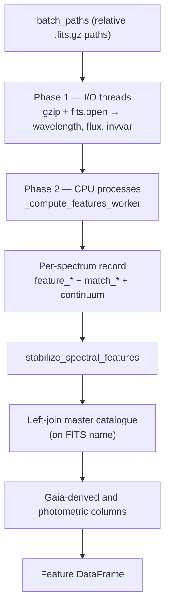

import RelatedPages from '@site/src/components/RelatedPages';

{/* facts: none — page derived from AS/src/pipeline/processing.py, peak_detector.py, feature_engineering.py (no run-level number) */}

# Processing Pipeline

`ProcessingPipeline` (`src/pipeline/processing.py`) is the component that converts a list of FITS files into **one feature row per spectrum**. It chains preprocessing, [peak detection](./peak-detection) and [feature engineering](./feature-engineering), then joins the master catalogue and adds Gaia-derived columns. This page describes the code path; it quotes no run-level result.

---

## Pipeline position



## Parallel execution

Each chunk of spectra (default 5,000) goes through two phases:

| Phase | Executor | Why |
|---|---|---|
| 1 — read | `ThreadPoolExecutor` (default 32 threads) | `gzip.open` / `fits.open` release the GIL, so threads overlap disk requests; `invvar` is cleaned with `sanitize_invvar` at load time |
| 2 — compute | `ProcessPoolExecutor` (default: one worker per CPU core) | True multi-core parallelism; each worker builds its own `SpectraPreprocessor`, `PeakDetector` and `FeatureEngineer` once through `_init_cpu_worker` |

A single process pool stays alive for the whole batch. Only `(file_path, wavelength, flux, invvar)` tuples are sent to workers; the module-level `_compute_features_worker` is used instead of a bound method so the pipeline object is never pickled. The defaults (32 I/O threads, 5,000-spectra chunks) are tuning constants in the module, not measured optima.

## What happens to one spectrum

`_compute_features_worker` runs these steps and returns a flat dictionary:

1. **Normalise** the flux (`SpectraPreprocessor.normalize_spectrum`).
2. **Detect and match lines** (`PeakDetector.analyze_spectrum`, with `prominence=0.15` and `window=8` Å unless overridden).
3. **Extract features** (`FeatureEngineer.extract_features`) from the matches, wavelength, normalised flux and inverse variance.
4. **Fit the global continuum shape**: a degree-2 polynomial over 4300–6800 Å gives `feature_cont_curvature` (quadratic coefficient) and `feature_cont_slope` (linear coefficient); both are 0.0 if fewer than 10 valid points remain.
5. **Assemble** the record: `file_path`, every `feature_*` in the stable order of `FeatureEngineer.feature_names`, the two continuum columns, and the `match_*` columns.

If any step raises, the spectrum returns `None` and is skipped; the pipeline prints the number of failed files but does not log the cause.

### Origin of the `match_*` columns

The matches returned by `PeakDetector` are flattened by `matches_to_series(matched_lines, order=FeatureEngineer.base_lines, prefix="match_")`. For each of the six base lines (`Hα`, `Hβ`, `CaII K`, `CaII H`, `Mg_b`, `Na_D`) two columns are produced — the detected wavelength and the prominence — so **12 `match_*` columns** per spectrum. Spaces are removed from names (`match_CaIIK_wl`, `match_CaIIK_prom`). An unmatched line gives NaN.

They **complement** the `feature_*` columns: `match_*` records *where* a minimum was found and how prominent it is; `feature_*` holds the measured quantities (prominence, FWHM, equivalent width, ratios, indices).

---

## After the workers: table-level steps

When a master catalogue is supplied, `run()` continues with operations that need the whole table:

| Step | Function | Notes |
|---|---|---|
| Stabilise features | `stabilize_spectral_features` | Applied before the merge |
| Join catalogue | `pd.merge(..., how="left", on="fits_name_only")` | Key = file name without `.gz` |
| Gaia-derived columns | `add_gaia_derived_features(min_parallax_snr=5.0)` | Includes `is_good_ruwe` (RUWE < 1.4) and absolute magnitudes |
| Line composites | `add_line_composites` | Failure is reported, not fatal |
| Main-sequence offset | `add_main_sequence_delta(min_parallax_snr=10.0)` | Degree-3 polynomial; stays NaN if too few clean stars |
| Colours | `feature_color_gr`, `feature_color_ri` from `magnitude_g/r/i` | Sentinel 99.0 → NaN; remaining NaN filled with 0 |
| Photometric composites | `add_photometric_composites` | Failure is reported, not fatal |
| Clean-up | drop `fits_name_only`, `dist_pc` and all-NaN columns; −9999 → NaN | |

Without a catalogue, `run()` returns the spectroscopic table only, with `label = "UNKNOWN"` if no label column exists.

:::warning[Gaia and photometric columns are produced here]
`ProcessingPipeline` always computes Gaia-derived and photometric columns when the catalogue provides them (`M_G`, `M_BP`, `M_RP`, `delta_ms`, colours…). It does **not** remove them. Excluding them is the job of the classifier (`SpectralClassifier(spectro_only=True)`) or of the dimensionality-reduction loader, as described in [`spectro_only` mode](../concepts/spectro-only-mode). The stub of this page referred to a "spectro_only mode switching" in the processing pipeline; no such switch exists in `processing.py`.
:::

---

## Usage

```python
# src/pipeline/processing.py
from pipeline.processing import ProcessingPipeline

pp = ProcessingPipeline(raw_data_dir, master_catalog_df, n_io_workers=32, prominence=0.15, window=8)
features_df = pp.run(batch_paths, chunk_size=5000)
```

In practice the call is made by [`MasterPipeline.process_data()`](./master-pipeline), which then writes `features_<timestamp>.csv`.

---

<RelatedPages pages={[
  { href: '/docs/astrospectro/pipeline/peak-detection', title: 'Peak Detection', desc: 'Source of the match_* columns', category: 'concepts' },
  { href: '/docs/astrospectro/pipeline/master-pipeline', title: 'Master Pipeline', desc: 'The orchestrator that calls ProcessingPipeline', category: 'concepts' },
  { href: '/docs/astrospectro/pipeline/feature-engineering', title: 'Feature Engineering', desc: 'Contents of the feature_* columns', category: 'concepts' },
  { href: '/docs/astrospectro/concepts/spectro-only-mode', title: 'spectro_only mode', desc: 'Where Gaia and photometric columns are excluded', category: 'concepts' },
  { href: 'https://github.com/PhD-Brown/AstroSpectro/blob/main/src/pipeline/processing.py', title: 'Source — processing.py', desc: 'ProcessingPipeline on GitHub', category: 'external' },
]} />
