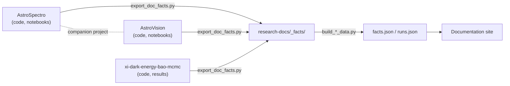

{/* facts: no numbers. Repository layout read (read-only) from the local clones of PhD-Brown/AstroSpectro, PhD-Brown/AstroVision and PhD-Brown/xi-dark-energy-bao-mcmc (top-level folders and README titles). */}

# Repository Map

This documentation site describes three research codebases. Each lives in its own repository; this page says what is in each one and where its documentation is. The code repositories are the source of truth for the code, and the documentation never modifies them.

| Repository | Topic | Main content | Documentation |
|---|---|---|---|
| [`PhD-Brown/AstroSpectro`](https://github.com/PhD-Brown/AstroSpectro) | Stellar spectroscopy, machine learning | `src/` (`pipeline/`, `dimred/`, `tools/`, `utils.py`), `notebooks/` (master pipeline, download, tools, validation, SHAP; `dimred/` for the PHY-3500 notebooks), `scripts/`, `data/`, `app.py`, `ROADMAP.md` | [AstroSpectro](../astrospectro/index.mdx) |
| [`PhD-Brown/AstroVision`](https://github.com/PhD-Brown/AstroVision) | Galaxy morphology, deep learning | `src/astrovision/` (data loading, models, fusion, uncertainty, Grad-CAM, morphometry, segmentation), `notebooks/` `00`–`10`, `requirements.txt` | [AstroVision](/astrovision) |
| [`PhD-Brown/xi-dark-energy-bao-mcmc`](https://github.com/PhD-Brown/xi-dark-energy-bao-mcmc) | Bayesian cosmological inference | `src/` (`xi_cosmo/`, protocol 1 and 1b run scripts), `notebooks/`, `results/`, `figures/`, `reports/`, `data/`, `docs/`, `tests/`, `Makefile`, `environment.yml`, `CITATION.cff` | [ξ Dark Energy](/xi-dark-energy) |
| [`PhD-Brown/research-docs`](https://github.com/PhD-Brown/research-docs) | This documentation site | `website/` (Docusaurus 3, three documentation instances), `_facts/` (exported facts per project), `scripts/`, `FACTS_INDEX.md` | You are here |
| [`PhD-Brown/PhD-Brown.github.io`](https://github.com/PhD-Brown/PhD-Brown.github.io) | Personal academic website | Not documented here | — |

---

## How the repositories relate

- **Facts flow one way.** A script in `research-docs` exports result files from a code repository into `_facts/<project>/`; other scripts turn them into the data files read by the documentation components. No published figure is typed by hand. The procedure is described in the project `FACTS_INDEX.md` files.
- **AstroVision is the companion of AstroSpectro.** The bridge between the two projects is described on [Bridge to AstroSpectro](/astrovision/overview/link-to-astrospectro).
- **The code repositories are read-only for the documentation.** Corrections to a code or a result are made in the code repository, then exported again.

## Where to look next

- Notebooks of the three projects: [Notebook Atlas](./notebook-atlas.md)
- Datasets of the three projects: [Datasets Index](./datasets-index.md)
- Methods used across the projects: [Methods Index](./methods-index.md)
